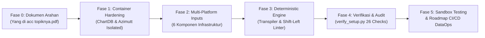

# 📜 Enterprise Data Management (EDM) Bank Raya - Project Journey & Audit Log
**Dokumentasi Rekam Jejak Arsitektur, Implementasi, dan Tata Kelola Data (DAMA-DMBOK V.2)**  
*Standar Keamanan: Banking-Grade Zero-Credential-Exposure & Zero Data Leakage*

---

## 🧭 Ringkasan Eksekutif Perjalanan Proyek

Dokumen ini mencatat seluruh alur evolusi proyek dari dokumen kebutuhan awal tulisan tangan manajemen, arsitektur kontainer, transpilasi multi-platform, hingga audit tata kelola data otomatis.



---

## 📌 Fase 0: Latar Belakang & Identifikasi Kebutuhan Awal

Berdasarkan dokumen arahan [Yang di acc topiknya.pdf](file:///D:/modelling-raya/Yang%20di%20acc%20topiknya.pdf):

1. **Kondisi Pipeline Data Eksisting**:
   * Alur data dari `dev` $\rightarrow$ `prod` $\rightarrow$ tulis ke database operasional $\rightarrow$ diekstrak ke BigQuery (`OLAP`) untuk lapisan `data raw` hingga `data mart` sudah berjalan baik dan *data lineage*-nya sudah terpetakan (*clear feasibility*).
2. **Kesenjangan (Pain Point / PR Utama)**:
   * **Data Modeling & Design (ERD)** belum memiliki tata kelola dan standarisasi tools di tahap awal data dibentuk (*early stage*).
   * BigQuery bersifat OLAP (bukan OLTP), sementara kebutuhan skema relasional datang dari unit operasional: **Tim Credit Scoring** dan **Tim Regulatory Reporting (SLIK/LBU)**.
3. **Arahan Solusi Terpilih**:
   * Gunakan kombinasi **ChartDB** (untuk diagramming interaktif cepat) dan **Azimutt** (untuk katalog skema enterprise multi-divisi).
   * Lakukan *containerization* menggunakan Docker.

---

## 🏗️ Fase 1: Perancangan Stack Container & Security Hardening

Pada tahap ini, dirancang topologi Docker Compose berstandar perbankan di [docker-compose.yml](file:///D:/modelling-raya/docker-compose.yml) dan konfigurasi lingkungan [.env](file:///D:/modelling-raya/.env):

| Komponen | Spesifikasi Teknis | Kebijakan Keamanan (*Hardening*) |
| :--- | :--- | :--- |
| **ChartDB Service** | Image `ghcr.io/chartdb/chartdb:latest`<br/>Port `8080:80` | **100% Stateless**: Tanpa persistent volume mount.<br/>`DISABLE_ANALYTICS=true` (matikan telemetri eksternal).<br/>`VITE_HIDE_CHARTDB_CLOUD=true` (cegah upload DDL ke cloud). |
| **Azimutt App** | Image `ghcr.io/azimuttapp/azimutt:main`<br/>Port `8000:4000` | **Separated Storage Architecture**:<br/>- `./azimutt-data/sources:/app/sources`<br/>- `./azimutt-data/layouts:/app/layouts`<br/>- `./azimutt-data/uploads:/app/bin/uploads` |
| **Azimutt DB** | Image `postgres:16-alpine`<br/>Internal Only | **Zero Exposed Ports**: Port 5432 **tidak diekspos ke host** sama sekali. Hanya terhubung ke bridge network internal. |
| **Network Topology** | Driver `bridge`<br/>Nama: `edm-secure-net` | Seluruh lalu lintas data metadata terisolasi dalam bridge tertutup. |
| **Credential Safety** | [.env.example](file:///D:/modelling-raya/.env.example) & [.gitignore](file:///D:/modelling-raya/.gitignore) | Password dan secret key acak 64-karakter dilindungi dari git commit. |

---

## 🌐 Fase 2: Pembangunan Contoh Artefak Multi-Platform (`inputs/multi_platform/`)

Dibuat 6 artefak statis realistis yang mewakili seluruh ekosistem data Bank Raya:

1. [oltp_postgres.sql](file:///D:/modelling-raya/inputs/multi_platform/oltp_postgres.sql): Core OLTP Scoring engine (`scoring.scorecard_rules`, `scoring.credit_applications`, PK UUID, FK, dan deskripsi kolom).
2. [oltp_mysql.sql](file:///D:/modelling-raya/inputs/multi_platform/oltp_mysql.sql): Channel Distribution mitra & keagenan (`channel.loan_disbursements`, `ENGINE=InnoDB`, `AUTO_INCREMENT`, FK ke scoring).
3. [oltp_sqlserver.sql](file:///D:/modelling-raya/inputs/multi_platform/oltp_sqlserver.sql): Legacy Core Agunan (`legacy.collateral_registers`, `IDENTITY(1,1)`, `NVARCHAR`, `sp_addextendedproperty`).
4. [olap_bigquery_ddl.sql](file:///D:/modelling-raya/inputs/multi_platform/olap_bigquery_ddl.sql): Data Warehouse 3-layer Medallion:
   - `dataraw.raw_applications` (ingest mentah CDC)
   - `datastaging.stg_applications` (cleansing & deduplikasi)
   - `datamart.fct_credit_scoring` (analitik risiko kredit dengan `STRUCT`)
   - `datamart.rpt_slik_ojk` (laporan kepatuhan regulasi bulanan)
5. [dbt_schema.yml](file:///D:/modelling-raya/inputs/multi_platform/dbt_schema.yml) & [airflow_batch_query.sql](file:///D:/modelling-raya/inputs/multi_platform/airflow_batch_query.sql):
   - Definisi data contracts dbt (`unique`, `not_null`, `relationships` test).
   - SQL batch orchestration Airflow (`@daily` DAG `dags_raya_credit_risk_pipeline`).
6. [superset_datasources.yaml](file:///D:/modelling-raya/inputs/multi_platform/superset_datasources.yaml):
   - Ekspor dataset Apache Superset dengan 5 metrik bisnis eksekutif (`avg_credit_score`, `total_approved_amount`, `high_risk_exposure`, `total_outstanding`, `npl_ratio`).

---

## ⚙️ Fase 3: Transpiler Deterministik & Shift-Left Linter

Skrip [sync_multiplatform_metadata.py](file:///D:/modelling-raya/scripts/sync_multiplatform_metadata.py) dibangun 100% berbasis aturan (deterministik tanpa LLM/AI):

### A. Output yang Dihasilkan
1. **Azimutt Official JSON Schema** ([bank_raya_unified_schema.json](file:///D:/modelling-raya/sources/bank_raya_unified_schema.json)):
   - Struktur resmi `JsonSchema.elm` Azimutt: `{"tables": [...], "relations": [...], "types": [...]}`.
   - Total: **8 tabel**, **4 relasi**, **1 tipe kustom**.
   - Diperkaya dengan dokumentasi dbt dan metrik Superset di atribut `comment`.
2. **ChartDB Unified SQL DDL** ([chartdb_unified_import.sql](file:///D:/modelling-raya/sources/chartdb_unified_import.sql)):
   - DDL ANSI/PostgreSQL kompatibel untuk di-import langsung di ChartDB.
3. **Azimutt Domain Layouts** ([bank_raya_domain_layouts.json](file:///D:/modelling-raya/layouts/bank_raya_domain_layouts.json)):
   - Membagi visibilitas ke dalam 5 domain arsitektur DAMA-DMBOK:
     * `oltp/core_and_channels`
     * `organize/bigquery_raw_to_mart`
     * `deliver/superset_executive_bi`
     * `teams/credit_scoring`
     * `teams/regulatory_reporting`

### B. Shift-Left Linter Rules & Hasil Temuan
* **`WARN-01` (Orphan Tables)**:
  - *Temuan*: `legacy.collateral_registers` dan `datamart.rpt_slik_ojk` tidak memiliki relasi FK masuk maupun keluar.
  - *Justifikasi*: Akurat merefleksikan arsitektur riil perbankan di mana modul agunan legacy dan pelaporan OJK sering kali berbentuk tabel snapshot/register independen.
* **`WARN-02` (Foreign Key Type Mismatch)**:
  - *Temuan*: `channel.loan_disbursements.application_id` (`VARCHAR(36)` di MySQL) $\rightarrow$ `scoring.credit_applications.application_id` (`UUID` di PostgreSQL).
  - *Justifikasi*: Deteksi dini sebelum terjadinya kegagalan integrasi pipeline CDC lintas engine database.
* **`WARN-03` (Primary Key & Contract Check)**:
  - *Status*: Seluruh 8 tabel terbukti memiliki PK valid, dan kontrak dbt `not_null` sesuai dengan definisi DDL.

---

## ✅ Fase 4: Rekam Jejak Audit Verifikasi ([verify_setup.py](file:///D:/modelling-raya/scripts/verify_setup.py))

Skrip audit otomatis memvalidasi 26 parameter kepatuhan teknis.

```text
===========================================================================
VERIFIKASI SISTEM EDM & DAMA-DMBOK: CHARTDB & AZIMUTT (BANKING GRADE)
===========================================================================
[PASS] docker-compose.yml ditemukan.
[PASS] Base image ChartDB resmi: 'ghcr.io/chartdb/chartdb:latest'
[PASS] Hardening: DISABLE_ANALYTICS dikonfigurasi
[PASS] Hardening: VITE_HIDE_CHARTDB_CLOUD dikonfigurasi
[PASS] Port forwarding ChartDB diatur ke 8080:80
[PASS] ChartDB terhubung ke jaringan 'edm-secure-net'
[PASS] Layanan ChartDB 100% Stateless (tanpa volume persistensi)
[PASS] Base image Azimutt resmi ghcr.io/azimuttapp/azimutt
[PASS] Port forwarding Azimutt diarahkan ke port lokal 8000
[PASS] Volume terpisah untuk direktori 'sources' terkonfigurasi
[PASS] Volume terpisah untuk direktori 'layouts' terkonfigurasi
[PASS] Azimutt terhubung ke jaringan terisolasi 'edm-secure-net'
[PASS] Backend Azimutt terisolasi di jaringan internal (tanpa port ke host)
[PASS] Direktori Sources Tim Scoring (DDL / SQL) ditemukan: scoring
[PASS] Direktori Sources Tim Reporting (DDL / SQL) ditemukan: reporting
[PASS] Direktori Layouts Tim Scoring (Views / Diagram) ditemukan: scoring
[PASS] Direktori Layouts Tim Reporting (Views / Diagram) ditemukan: reporting
[PASS] File .env aktif untuk perlindungan Zero-Credential-Exposure.
[PASS] Artefak Multi-Platform ditemukan: PostgreSQL Core Scoring DDL (oltp_postgres.sql)
[PASS] Artefak Multi-Platform ditemukan: MySQL Channel Partner DDL (oltp_mysql.sql)
[PASS] Artefak Multi-Platform ditemukan: SQL Server Legacy Collateral DDL (oltp_sqlserver.sql)
[PASS] Artefak Multi-Platform ditemukan: BigQuery 3-Layer Medallion DDL (olap_bigquery_ddl.sql)
[PASS] Artefak Multi-Platform ditemukan: dbt Data Contracts & Governance Catalog (dbt_schema.yml)
[PASS] Artefak Multi-Platform ditemukan: Airflow Batch Orchestration Query (airflow_batch_query.sql)
[PASS] Artefak Multi-Platform ditemukan: Superset BI Datasets & Metrics Export (superset_datasources.yaml)
[PASS] Skrip transpiler ditemukan: sync_multiplatform_metadata.py
[PASS] Eksekusi 'sync_multiplatform_metadata.py' sukses (Exit Code 0).
[PASS] Azimutt Schema Valid (8 tabel, 4 relasi): sources\bank_raya_unified_schema.json
[PASS] Azimutt Schema Valid (8 tabel, 4 relasi): azimutt-data\sources\bank_raya_unified_schema.json
[PASS] ChartDB Unified SQL Import ditemukan: sources\chartdb_unified_import.sql
[PASS] ChartDB Unified SQL Import ditemukan: azimutt-data\sources\chartdb_unified_import.sql
[PASS] Azimutt Domain Layouts Valid (5 domain): layouts\bank_raya_domain_layouts.json
[PASS] Azimutt Domain Layouts Valid (5 domain): azimutt-data\layouts\bank_raya_domain_layouts.json
===========================================================================
HASIL: SEMUA SPESIFIKASI TEKNIS & KEAMANAN TERVERIFIKASI 100% VALID (26/26)
===========================================================================
```

---

## 🚀 Fase 5: Status Saat Ini & Roadmap Otomasi Produksi

| Dimensi | Status Saat Ini (Sandbox / PoC) | Target Produksi (Enterprise DataOps) |
| :--- | :--- | :--- |
| **Eksekusi Stack** | Manual via `docker compose up -d` di laptop | Berjalan 24/7 sebagai background service (Kubernetes / Docker Daemon VM). |
| **Sinkronisasi Metadata** | Manual via `python scripts/sync_multiplatform_metadata.py` | Otomatis dipicu oleh **GitLab CI / GitHub Actions** setiap kali ada commit/PR DDL baru. |
| **Audit Skema (Linter)** | Dijalankan di terminal lokal developer | Gatekeeper otomatis: jika ditemukan error, PR ditahan untuk review data architect. |
| **Lineage Refresh** | Statis berdasarkan contoh file dbt & Airflow | Terintegrasi langsung dengan Webhook Airflow DAG `@daily` pasca-batch selesai. |

---

## ⚡ Fase 6: Realisasi 4 Skenario Otomasi Enterprise (DataOps)

Telah diimplementasikan rangkaian modul otomasi untuk menghapus kebutuhan intervensi manual:

1. **Otomasi Live-Reload Saat Coding Lokal ([watch_and_sync.py](file:///D:/modelling-raya/scripts/watch_and_sync.py))**:
   - Memantau folder `inputs/multi_platform/` secara real-time.
   - Setiap kali file SQL/YAML disimpan (`Ctrl + S`), otomatis menjalankan transpiler, linter, dan mengupdate volume container Azimutt tanpa perlu mengetik perintah terminal berulang kali.
2. **Otomasi Kamus Data HTML Offline ([generate_data_dictionary.py](file:///D:/modelling-raya/scripts/generate_data_dictionary.py))**:
   - Menghasilkan berkas mandiri [docs/data_dictionary.html](file:///D:/modelling-raya/docs/data_dictionary.html) yang dapat dibuka langsung di browser Chrome/Edge tanpa Docker, dilengkapi fitur pencarian kolom real-time, kamus data lengkap, dan diagram ERD Mermaid.
3. **Otomasi CI/CD & Gatekeeper PR ([.github/workflows/data_ops_pipeline.yml](file:///D:/modelling-raya/.github/workflows/data_ops_pipeline.yml))**:
   - Menguji linter dan mengarsipkan seluruh katalog data sebagai GitHub Actions artifact yang siap diunduh dalam 1 klik.

---
*Laporan ini dipelihara secara otomatis sebagai bagian dari Tata Kelola Metadata Enterprise Bank Raya.*
