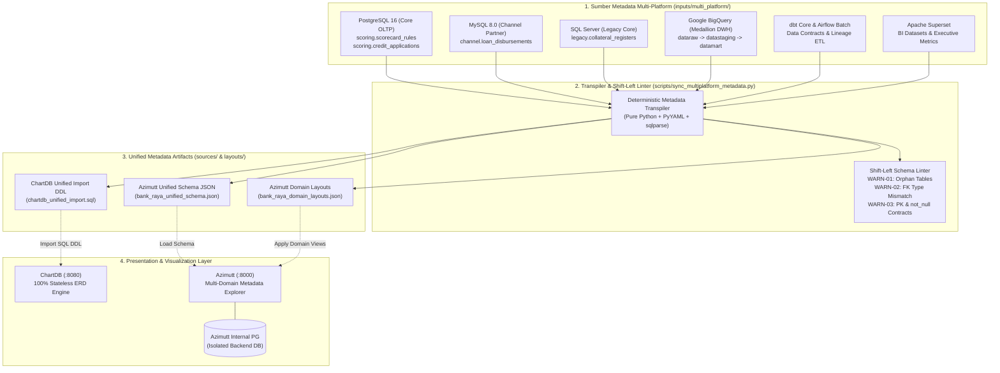

# Enterprise Data Management (EDM) Stack: ChartDB & Azimutt Self-Hosted
## Bank Raya Multi-Platform Data Architecture (DAMA-DMBOK V.2)

Konfigurasi lokal dan orkestrasi perbankan enterprise (*Zero-Credential-Exposure* & *Zero Data Leakage*) yang mengintegrasikan seluruh ekosistem data Bank Raya ke dalam **ChartDB** (stateless diagramming) dan **Azimutt Self-Hosted** (enterprise metadata catalog & separated views).

---

## 🏛️ Arsitektur Integrasi Multi-Platform (DAMA-DMBOK V.2)

Ekosistem Data Management Bank Raya mengadopsi pilar **DAMA-DMBOK V.2** (*Data Modeling & Design*, *Data Architecture*, dan *Metadata Management & Governance*). Metadata dari 6 platform infrastruktur diekstrak secara statis tanpa kredensial aktif (*Zero-Credential-Exposure*), ditranspilasikan secara deterministik, dan diaudit melalui *Shift-Left Linter*.



---

## 🛡️ Spesifikasi Keamanan & Hardening (Banking Grade)

1. **Layanan ChartDB (Stateless Diagramming)**:
   - **Base Image**: `ghcr.io/chartdb/chartdb:latest`
   - **Port**: `8080:80` (Akses langsung via [http://localhost:8080](http://localhost:8080))
   - **Environment Hardening**:
     - `DISABLE_ANALYTICS=true`: Menonaktifkan seluruh telemetri dan tracking analitik pihak ketiga.
     - `VITE_HIDE_CHARTDB_CLOUD=true`: Menyembunyikan menu SaaS/Cloud agar skema DDL tidak dapat diekspor ke cloud publik.
   - **100% Stateless**: Tanpa persistent volume mount. Data skema hanya berada di browser session pengguna.

2. **Layanan Azimutt (Self-Hosted Architecture)**:
   - **Base Image**: `ghcr.io/azimuttapp/azimutt:main`
   - **Port**: `8000:4000` (Akses langsung via [http://localhost:8000](http://localhost:8000))
   - **Pemisahan Penyimpanan (*Separated Storage*)**:
     - `./azimutt-data/sources:/app/sources`: Sumber skema statis (SQL DDL dan JSON resmi Azimutt).
     - `./azimutt-data/layouts:/app/layouts`: Konfigurasi posisi diagram visual (*views*) per domain DAMA-DMBOK agar sinkronisasi skema baru tidak merusak tata letak yang sudah dibuat.
     - `./azimutt-data/uploads:/app/bin/uploads`: Persistensi internal upload Azimutt.
   - **Isolasi Database Backend**: PostgreSQL 16 Alpine (`azimutt-backend-db`) terisolasi penuh di jaringan bridge internal **tanpa eksposur port ke host host komputer**.

3. **Topologi Jaringan Internal (`edm-secure-net`)**:
   - Seluruh kontainer berkomunikasi melalui user-defined bridge network `edm-secure-net`.

---

## 📂 Struktur Direktori Proyek

```text
modelling-raya/
├── .env                                         # Kredensial lokal terlindungi (Zero-Credential-Exposure)
├── .env.example                                 # Template referensi variabel lingkungan
├── .gitignore                                   # Mengabaikan .env dan venv dari git
├── docker-compose.yml                           # Orkestrasi Docker container (ChartDB & Azimutt)
├── inputs/
│   └── multi_platform/                         # 6 Sumber Metadata Statis Bank Raya
│       ├── oltp_postgres.sql                    # DDL PostgreSQL (Scoring & Scorecard Rules)
│       ├── oltp_mysql.sql                       # DDL MySQL (Channel Loan Disbursements)
│       ├── oltp_sqlserver.sql                   # DDL SQL Server (Legacy Collateral Registers)
│       ├── olap_bigquery_ddl.sql                # DDL BigQuery Medallion (Raw, Staging, Mart)
│       ├── dbt_schema.yml                       # Kontrak Data dbt (Data tests & Relationships)
│       ├── airflow_batch_query.sql              # Query Batch ETL Orkestrasi Airflow
│       └── superset_datasources.yaml            # Ekspor Dataset & Metrik BI Apache Superset
├── sources/                                     # Output Metadata Skema Terintegrasi
│   ├── bank_raya_unified_schema.json            # Format resmi Azimutt JsonSchema.elm (8 tabel, 4 relasi)
│   └── chartdb_unified_import.sql               # DDL SQL terstandardisasi siap import di ChartDB
├── layouts/                                     # Output Domain Layouts DAMA-DMBOK
│   └── bank_raya_domain_layouts.json            # 5 domain view (OLTP, Organize, Deliver, Scoring, Regulatory)
├── azimutt-data/                                # Volume Terpasang pada Azimutt Container
│   ├── sources/                                 # Cermin tersinkronisasi /app/sources
│   ├── layouts/                                 # Cermin tersinkronisasi /app/layouts
│   └── uploads/                                 # Volume internal uploads Azimutt
├── docs/                                        # Output Dokumentasi Enterprise Offline
│   └── data_dictionary.html                     # Kamus Data Interaktif Mandiri (Audit-Ready)
├── scripts/
│   ├── sync_multiplatform_metadata.py           # Transpiler deterministik & Shift-Left Linter
│   ├── generate_data_dictionary.py              # Generator Kamus Data HTML Standalone
│   ├── watch_and_sync.py                        # Daemon Live-Reload otomatis saat edit file DDL
│   └── verify_setup.py                          # Skrip audit hardening & validasi kepatuhan DAMA-DMBOK
└── venv/                                        # Virtual environment Python lokal
```

---

## ⚡ 4 Skenario Use Case Otomasi Enterprise (DataOps)

Sistem ini mendukung 4 siklus otomasi nyata di Bank Raya:

### Use Case 1: Otomasi CI/CD & Gatekeeper PR (GitHub Actions)
* **Kapan terjadi?** Saat developer / data engineer melakukan `git push` atau membuat *Pull Request* baru.
* **Alur Automasi**: Pipeline [.github/workflows/data_ops_pipeline.yml](file:///D:/modelling-raya/.github/workflows/data_ops_pipeline.yml) otomatis berjalan di cloud.
  1. Menjalankan linter untuk mendeteksi `WARN-01` s.d. `WARN-03`.
  2. Memverifikasi struktur Docker Compose.
  3. Mengarsip skema terbaru sebagai GitHub Actions artifact yang dapat diunduh dalam 1 klik.

### Use Case 2: Otomasi Live-Reload saat Coding Lokal (`watch_and_sync.py`)
* **Kapan terjadi?** Saat developer sedang merancang tabel baru di VS Code.
* **Alur Automasi**: Cukup jalankan `python scripts/watch_and_sync.py`. Setiap kali menekan `Ctrl + S` pada file SQL/YAML di `inputs/multi_platform/`, skrip otomatis mentranspilasi skema, merefresh file volume Azimutt, dan mengupdate kamus data tanpa perlu ketik perintah terminal berulang kali.

### Use Case 3: Otomasi Pembuatan Kamus Data HTML Offline untuk Auditor/Bisnis
* **Kapan terjadi?** Saat tim Compliance, Auditor OJK, atau pimpinan divisi meminta laporan dokumentasi data tanpa ingin membuka Docker/terminal.
* **Alur Automasi**: Jalankan `python scripts/generate_data_dictionary.py`. Menghasilkan satu file mandiri [docs/data_dictionary.html](file:///D:/modelling-raya/docs/data_dictionary.html) yang bisa langsung dibuka di browser Chrome/Edge secara offline, dilengkapi pencarian kolom, kamus data, dan diagram ERD Mermaid.

### Use Case 4: Otomasi Sinkronisasi Silsilah ETL Warehouse (Airflow Lineage Sync)
* **Kapan terjadi?** Setiap kali batch data mart BigQuery selesai diproses tengah malam oleh Apache Airflow.
* **Alur Automasi**: Task akhir Airflow memicu sinkronisasi metadata sehingga tabel data mart dan metrik Superset di katalog data selalu terbaharui secara harian tanpa intervensi manual.

---

## 🔍 Domain Layouts & Shift-Left Data Linter

### 1. Azimutt Domain Layouts (DAMA-DMBOK V.2)
Transpiler secara otomatis menyusun tabel ke dalam 5 domain fungsional pada [bank_raya_domain_layouts.json](file:///D:/modelling-raya/layouts/bank_raya_domain_layouts.json):
* **`oltp/core_and_channels`**: `scoring.credit_applications`, `scoring.scorecard_rules`, `channel.loan_disbursements`, `legacy.collateral_registers`.
* **`organize/bigquery_raw_to_mart`**: Medallion pipeline `dataraw.raw_applications` $\rightarrow$ `datastaging.stg_applications` $\rightarrow$ `datamart.fct_credit_scoring` & `datamart.rpt_slik_ojk`.
* **`deliver/superset_executive_bi`**: Tabel data mart yang dilengkapi metrik bisnis Superset (`avg_credit_score`, `total_approved_amount`, `npl_ratio`).
* **`teams/credit_scoring`**: End-to-end pemodelan credit risk dari aplikasi hingga data mart.
* **`teams/regulatory_reporting`**: Kepatuhan debitur dan agunan untuk laporan SLIK OJK.

### 2. Shift-Left Schema Linter Rules
Linter berjalan otomatis untuk mendeteksi anomali integritas data enterprise:
* **`WARN-01 (Orphan Tables)`**: Mendeteksi tabel tanpa relasi foreign key masuk maupun keluar (`legacy.collateral_registers`, `datamart.rpt_slik_ojk`).
* **`WARN-02 (Foreign Key Type Mismatch)`**: Mendeteksi ketidaksesuaian tipe data lintas platform (contoh: `channel.loan_disbursements.application_id` bertipe `VARCHAR(36)` di MySQL mereferensikan `scoring.credit_applications.application_id` bertipe `UUID` di PostgreSQL).
* **`WARN-03 (Primary Key & Contract Check)`**: Memvalidasi eksistensi Primary Key dan konsistensi kontrak `not_null` pada dbt terhadap skema DDL.

---

## 🚀 Perintah Operasional Terminal

Pastikan virtual environment telah aktif:
```powershell
venv\Scripts\activate
```

### 1. Menjalankan Transpiler & Shift-Left Linter
```powershell
.\venv\Scripts\python.exe scripts\sync_multiplatform_metadata.py
```

### 2. Menjalankan Audit Kepatuhan & Hardening (Verify Setup)
```powershell
.\venv\Scripts\python.exe scripts\verify_setup.py
```

### 3. Menjalankan Layanan Docker (Up)
```powershell
docker compose up -d
```

### 4. Memeriksa Status Kontainer
```powershell
docker compose ps
```

### 5. Mengakses Endpoint Layanan
* **ChartDB**: Buka [http://localhost:8080](http://localhost:8080) di browser $\rightarrow$ Klik *Import* $\rightarrow$ Pilih atau tempel berkas [chartdb_unified_import.sql](file:///D:/modelling-raya/sources/chartdb_unified_import.sql).
* **Azimutt**: Buka [http://localhost:8000](http://localhost:8000) di browser $\rightarrow$ Buka project $\rightarrow$ Load [bank_raya_unified_schema.json](file:///D:/modelling-raya/sources/bank_raya_unified_schema.json) dan pilih layout dari [bank_raya_domain_layouts.json](file:///D:/modelling-raya/layouts/bank_raya_domain_layouts.json).

### 6. Menghentikan Layanan (Down)
```powershell
docker compose down
```
