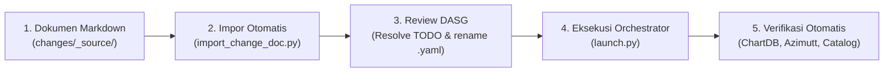

# Panduan Prosedur Change Request (CR) Arsitektur Data Bank Raya
**Standar: DAMA-DMBOK V.2 & PT Bank Raya Indonesia Tbk (DASG Governance)**

Dokumen ini adalah panduan standar satu halaman bagi Data Engineer, Data Architect, dan Business Analyst untuk mengajukan penambahan tabel baru (*new table*) atau penambahan kolom (*add columns*) secara otomatis **tanpa mengubah kode Python/pipeline**.

---

### 1. Dokumen yang Harus Disiapkan Pengaju
1. **Tiket Permintaan Formal (Jira)**: Nomor tiket resmi (contoh: `EDM-4012`).
2. **Dokumen Template Data Modeling (`Data Modeling.md`)**:
   - Metadata tabel: Nama Database, Nama Schema, Nama Tabel, Versi, Jenis Perubahan (`New Table` / `Add Columns`), dan Deskripsi Tabel.
   - Definisi kolom: Nama Kolom, Tipe Data, Status PII (`Yes`/`No`), Data Rules/Validation, dan Deskripsi Bisnis.
3. **Data Governance & Ownership**:
   - **Data Domain & Sub-domain**: Mengacu pada taksonomi resmi di `config/domains.yaml`.
   - **Data Roles**: Data Owner (Kadiv), Data Steward (PIC Analis), dan Data Custodian (Tim DE).

---

### 2. Alur Eksekusi (Langkah Demi Langkah)



#### Langkah 1: Simpan Dokumen Sumber
Letakkan file markdown di folder `changes/_source/Data Modeling.md`.

#### Langkah 2: Eksekusi Impor Konservatif
Jalankan skrip parser untuk menghasilkan draft manifest YAML:
```bash
python scripts/import_change_doc.py
```
*Output: Menghasilkan file `changes/<table_name>.draft.yaml` dengan penanda `# TODO(review)` pada atribut penting.*

#### Langkah 3: Finalisasi Manifest (Review DASG)
1. Buka file `changes/<table_name>.draft.yaml`.
2. Selesaikan seluruh penanda `# TODO(review)` (tentukan Primary Key, Domain, Subdomain, Data Owner, dan Relasi).
3. Ubah ekstensi file dari `.draft.yaml` menjadi `.yaml`.

#### Langkah 4: Validasi & Jalankan Pipeline
Jalankan master orchestrator:
```bash
python scripts/launch.py --no-browser
```
*Pipeline akan otomatis memvalidasi manifest, mengompilasi SSoT skema terpadu, menghitung posisi layout kanvas tanpa tumpang tindih, memanggang container Nginx, memperbarui katalog, dan memverifikasi kesehatan sistem.*

---

### 3. Daftar Error Umum dan Solusinya

| Pesan Error | Penyebab | Solusi |
|---|---|---|
| `[FAIL] File draft terdeteksi pada changes/: [*.draft.yaml]` | Masih terdapat file berakhiran `.draft.yaml` di folder `changes/`. Pipeline menolak mengeksekusi build jika draft belum di-finalize. | Selesaikan seluruh TODO dan ubah nama file menjadi `.yaml`. |
| `[FAIL] Domain 'XYZ' tidak valid / tidak dikenal` | Nilai `domain` pada manifest tidak terdaftar dalam standar DASG. | Periksa daftar domain sah di `config/domains.yaml` (misal: `LENDING`, `DEPOSIT`, `TRANSACTIONS`). |
| `[FAIL] Data owner wajib diisi (--strict aktif)` | Flag `--strict` aktif namun atribut `owners.data_owner` masih kosong / null. | Masukkan email resmi Data Owner dari tiket Jira. |
| `[FAIL] Konflik tipe kolom 'col_name': eksisting 'TYPE_A' vs baru 'TYPE_B'` | Pada `add_columns`, kolom yang diajukan sudah ada dengan tipe data berbeda. | Periksa apakah ada perubahan tipe data (breaking change) atau salah ketik tipe. |
| `[FAIL] Relasi 'fk_name' mereferensikan kolom yang tidak ada` | Kolom sumber atau kolom target pada foreign key tidak ditemukan di skema. | Pastikan nama kolom dan tabel target dieja dengan benar sesuai skema model. |
| `[FAIL] Tumpang tindih kanvas terdeteksi` | Koordinat manual pada `config/layout_overrides.yaml` menabrak tabel lain. | Hapus override agar sistem menghitung posisi otomatis atau sesuaikan koordinat X/Y. |
| `[SECURITY FAIL] Alamat IPv4 internal terdeteksi` | Manifest atau payload memuat alamat IP internal (misal: `172.18.99.10`). | Hapus IP database internal dari file manifest publik; gunakan penamaan logis platform. |
| `[FAIL] Image basi! SHA256 live != host` | Container ChartDB berjalan dengan image lama yang belum diperbarui. | Jalankan `docker compose up -d --build` untuk memanggang image baru. |
